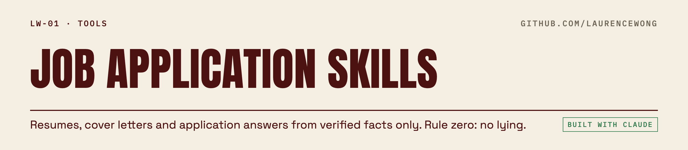

<picture>
  <source media="(prefers-color-scheme: dark)" srcset=".github/assets/lw01-dark.png">
  
</picture>

Five Claude Code skills that help you apply for jobs **without lying**.

I built these for my own job search. They tailor a resume to one posting, write a short cover letter that sounds like a person, answer the application form, and fill the applicant-tracking form in a browser. One rule shaped everything. The agent may only use facts you have written down and confirmed. When a posting asks for something you can't prove, it leaves a `[FILL]` and asks you. It never papers over the gap with adjectives.

| Skill | What it does |
|---|---|
| [`tailor-resume`](skills/tailor-resume/SKILL.md) | Maps the posting's must-haves to your verified facts, flags gaps, rewrites and reorders bullets, and exports a one-page PDF. |
| [`write-cover-letter`](skills/write-cover-letter/SKILL.md) | 250 words max, in your voice, grounded in your facts, then checked for AI tells. |
| [`answer-job-questions`](skills/answer-job-questions/SKILL.md) | Answers form questions from your standing answers bank and asks you for anything it doesn't know. |
| [`remove-ai-tells`](skills/remove-ai-tells/SKILL.md) | Scans for buzzwords, em-dash pauses, "not X but Y" mirrors, colon reveals and uniform bullet skeletons, then rewrites in your voice without touching a single fact. |
| [`apply-for-job`](skills/apply-for-job/SKILL.md) | Runs the whole flow and fills the form, then stops. Nothing is submitted until you say "submit." |

## Why "no lying" is the whole design
An agent that writes resumes will happily invent a metric, round 6 years up to "10+", or turn "managed PMs" into "led a multi-layer org", because that's what a strong resume looks like. These skills block that structurally:

- **One source of truth.** Every claim comes from `career/career-facts.md`, a file you write and confirm. Numbers are copied exactly, never "improved."
- **Gaps are shown, not hidden.** Every must-have in the posting maps to a fact or gets marked GAP, and you see the list.
- **Standing answers are dated.** Sponsorship, notice period, demographics and salary come only from `career/application-answers.md`, with the date you said it. Unknown means ask.
- **A human gate on anything outward.** The agent fills the form and screenshots it. You say "submit."

## Example: what remove-ai-tells changed on my own resume
These are real bullets from my resume, before and after. The facts didn't move.

| Before | After |
|---|---|
| **Shopping list:** relaunched the list with coupons, rewards and deals built in: $10.4M in incremental annual revenue and +42% add-to-cart among 1.1M weekly active users. | Relaunched the shopping list with coupons and rewards built in. It added $10.4M in annual revenue and lifted add-to-cart 42% among 1.1M weekly active users. |
| **Rewards:** raised reward redemption 60% with targeted notifications, cutting churn 18% and lifting average basket $3.40. | Targeted notifications raised reward redemption 60%, cut churn 18% and lifted average basket $3.40. |

The giveaway wasn't any single word. It was that every bullet had the same shape: a bold label, a colon, then a metric. The checker flags that pattern; a person decides what to do about it.

## Setup
1. Copy `skills/*` into your project's `.claude/skills/` (or `~/.claude/skills/`).
2. Create a `career/` folder from `templates/`:
   - `career-facts.md`: roles, dates, titles and every number you're willing to defend in an interview.
   - `application-answers.md`: your standing answers to HR questions.
   - `voice-profile.md`: how you actually write, so cover letters sound like you.
3. PDF export needs `pandoc` and a headless Chromium (the script uses Playwright for Python): `python3 scripts/render_resume.py career/resume-<company>.md`.

Then send Claude a job link: "tailor my resume for this", or "apply for this."

## What it won't do
- Create accounts or set passwords on job sites. It hands that step to you.
- Enter government ID numbers or bank details.
- Submit without your explicit "submit" for that specific job.
- Volunteer a salary number you haven't set.

## What broke while I built this
- **Bullets rendered as paragraphs.** Markdown lists need a blank line above them. My first PDFs collapsed every bullet into one run-on block, and I didn't notice until I looked at the page.
- **Dropdowns ignored the agent.** Greenhouse uses custom select menus that don't respond to scripted clicks. Typing into the field and pressing Enter works.
- **"How did you hear about us?" allows one answer.** I gave two true answers, so the skill now picks one and tells me which.
- **My own resume failed my own checker.** About 15 flags on the version I'd already sent out. Nothing false in it, just a lot of template rhythm.

## Built with Claude, and how
Claude Code wrote most of the text and scripts here. I set the rules (no lying, a human submit gate, a dated answers bank), decided what the agent may never do, and I use these for my own applications. That split, where I'm the editor and the rule-maker and the agent does the drafting, is the point.

## License
MIT
